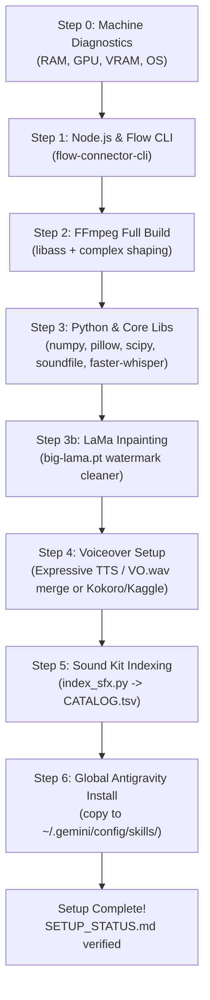
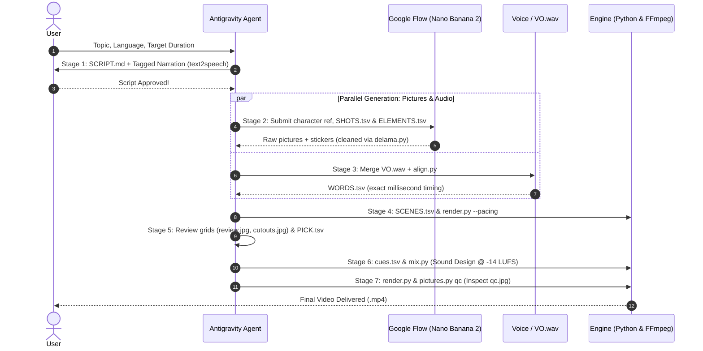

# Stickman Hybrid Animation & Documentary System
### Antigravity Agent Edition · Viral Documentary Explainer Pipeline

An end-to-end autonomous video production pipeline designed for **Antigravity**. It generates viral, high-retention documentary explainer videos in the **Hybrid Look**—combining full-color scene illustrations (Google Flow / Nano Banana 2), pop-in cut-out stickers, paper collage beats, animated counters, expressive multilingual narration, and broadcast-grade sound design (-14 LUFS).

---

## Table of Contents

1. [Quick Start for Antigravity Users](#1-quick-start-for-antigravity-users)
2. [One-Time Agent Setup Guide](#2-one-time-agent-setup-guide)
   - [Step 0: Machine Profiling & Diagnostics](#step-0-machine-profiling--diagnostics)
   - [Step 1: Node.js & Google Flow Connector CLI](#step-1-nodejs--google-flow-connector-cli)
   - [Step 2: FFmpeg Full Build (with libass & Complex Text Shaping)](#step-2-ffmpeg-full-build-with-libass--complex-text-shaping)
   - [Step 3: Python Environment & Core Packages](#step-3-python-environment--core-packages)
   - [Step 3b: LaMa Inpainting Watermark Remover](#step-3b-lama-inpainting-watermark-remover)
   - [Step 4: Voiceover Pipeline & Audio Options](#step-4-voiceover-pipeline--audio-options)
   - [Step 5: Sound Kit Setup & Catalog Indexing](#step-5-sound-kit-setup--catalog-indexing)
   - [Step 6: Global Antigravity Skill Installation](#step-6-global-antigravity-skill-installation)
3. [Current Machine Status (`SETUP_STATUS.md`)](#3-current-machine-status-setup_statusmd)
4. [End-to-End 7-Stage Production Workflow](#4-end-to-end-7-stage-production-workflow)
5. [Project Architecture & File Directory](#5-project-architecture--file-directory)
6. [Toolkit Reference](#6-toolkit-reference)
7. [Troubleshooting & Common Edge Cases](#7-troubleshooting--common-edge-cases)

---

## 1. Quick Start for Antigravity Users

### How to Run

1. Open this unzipped folder (`stickman-animation`) as your workspace in **Antigravity**.
2. Make sure you have Flow Connector installed in your browser. (Open the extension side panel → **Setup** → **Copy setup prompt** → paste into your Antigravity chat).
3. Type any of these commands in the Antigravity chat:
   - `start` or `stickman hybrid start` — start a new video
   - `continue` or `stickman hybrid continue` — resume an existing project
   - Or simply type a documentary topic (e.g. *"How Did Ancient Humans Clean Their Teeth?"* or *"इंसानों ने पहली नाव कैसे बनाई?"*)

### The 3 User Checkpoints

Antigravity handles all underlying scripts, downloads, keying, alignment, and rendering autonomously. As a user, you only review **3 checkpoints**:
1. **The Script & Expressive Tags:** Approve the story, hook, facts, and tagged script.
2. **The Voice:** Review the audio (merge `VO.wav` or approve automated voice).
3. **The Final Video:** Antigravity delivers the finished high-definition `.mp4` video.

---

## 2. One-Time Agent Setup Guide

This section is the definitive runbook for an Antigravity agent or developer to configure and verify all required system tools on the host computer.



---

### Step 0: Machine Profiling & Diagnostics

Before installing, check the host machine's hardware capabilities:

```powershell
# Windows PowerShell Hardware Check
Get-CimInstance Win32_OperatingSystem | Select-Object Caption, TotalVisibleMemorySize, FreePhysicalMemory
Get-CimInstance Win32_VideoController | Select-Object Name, AdapterRAM
Get-PSDrive C | Select-Object Used, Free
```

**Sizing Criteria:**
- **Strong Machine** (NVIDIA GPU with ≥ 8 GB VRAM, or ≥ 16 GB system RAM): Can run local neural voice synthesis (Indic Parler-TTS) and fast Whisper alignment.
- **Standard / Lightweight Machine** (Integrated GPU or < 8 GB VRAM): Use user-merged Expressive TTS (`VO.wav`) or run voice synthesis on Kaggle's free GPU tier (T4). Faster-whisper CPU alignment runs smoothly on any modern machine.

---

### Step 1: Node.js & Google Flow Connector CLI

*Benefit: Enables terminal-driven autonomous image generation with Google Flow (Nano Banana 2).*

1. **Verify or Install Node.js (v20 or newer required):**
   ```powershell
   node --version
   npm --version
   ```
   *If missing or older than v20:*
   - Windows: `winget install OpenJS.NodeJS.LTS`
   - macOS: `brew install node`
   - Linux: `sudo apt install nodejs npm`
2. **Install or Update `flow-connector-cli`:**
   ```powershell
   npm install -g flow-connector-cli@latest
   flow-auto --version
   ```
3. **Verify Agent Bridge & Skill:**
   ```powershell
   flow-auto doctor --site flow
   ```
   > [!NOTE]
   > "Bridge not running" or "Extension not connected" is expected during initial setup. The bridge starts automatically on the first generation step, and the browser extension connects whenever a Google Flow tab is active.

---

### Step 2: FFmpeg Full Build (with libass & Complex Text Shaping)

*Benefit: Essential engine for cutting frames on spoken words, chroma-keying stickers, mixing audio to YouTube loudness (-14 LUFS), and rendering Devanagari Hindi conjuncts (श्री, क्ष, त्रि).*

> [!IMPORTANT]
> A basic FFmpeg build is NOT sufficient. The build must include `libass` and HarfBuzz/FriBidi with `shaping=complex`. Pillow alone breaks Devanagari conjuncts and matras.

1. **Install FFmpeg Full Build:**
   - Windows: `winget install Gyan.FFmpeg`
   - macOS: `brew install ffmpeg`
   - Linux: `sudo apt install ffmpeg libass-dev`
2. **Verify Filter & ASS Support:**
   ```powershell
   ffmpeg -version
   ffmpeg -hide_banner -filters | Select-String "ass"
   ```
3. **Run Complex Text Rendering Selfcheck:**
   ```powershell
   python skills/stickman-hybrid/scripts/render.py --selfcheck
   ```
   *Verify:* Generates `selfcheck_<look>.png` across all 5 aesthetic looks (`bright`, `warm`, `ink`, `night`, `painted`). Open `selfcheck_warm.png` to ensure Hindi conjuncts (श्री, क्ष, त्रि) are properly joined without broken ligatures.

---

### Step 3: Python Environment & Core Packages

*Benefit: Drives the scene composition engine, sticker magenta chroma-keying, faster-whisper word timing, and audio leveling.*

1. **Verify Python (3.11–3.13 recommended, 3.12 safest for wheels):**
   ```powershell
   python --version
   ```
2. **Install Core Numerical & Audio Libraries:**
   ```powershell
   python -m pip install --upgrade pip
   python -m pip install numpy pillow scipy soundfile faster-whisper
   ```
3. **Verify Checkpoint:**
   ```powershell
   python -c "import numpy, PIL, scipy, soundfile, faster_whisper; print('Core Python Packages: OK')"
   ```

---

### Step 3b: LaMa Inpainting Watermark Remover

*Benefit: Google Flow pictures carry a subtle Gemini sparkle in the bottom-right corner. LaMa paints it out with pristine fidelity, leaving every adjacent pixel untouched.*

1. **Install PyTorch (CPU build is lightweight and completely sufficient):**
   ```powershell
   python -c "import torch; print('Torch:', torch.__version__)"
   # If not installed:
   python -m pip install torch
   ```
2. **Download the Official LaMa Model (`big-lama.pt` - 206 MB):**
   - URL: `https://github.com/enesmsahin/simple-lama-inpainting/releases/download/v0.1.0/big-lama.pt`
   - Destination: `~/.cache/lama/big-lama.pt` (Windows: `C:\Users\<me>\.cache\lama\big-lama.pt`)
   - Exact file size check: `205,803,670` bytes.

   *PowerShell Download Command:*
   ```powershell
   $destDir = "$HOME\.cache\lama"
   if (!(Test-Path $destDir)) { New-Item -ItemType Directory -Path $destDir -Force }
   $destFile = "$destDir\big-lama.pt"
   if (!(Test-Path $destFile)) {
       Invoke-WebRequest -Uri "https://github.com/enesmsahin/simple-lama-inpainting/releases/download/v0.1.0/big-lama.pt" -OutFile $destFile
   }
   ```
3. **Verify LaMa Selfcheck:**
   ```powershell
   python skills/stickman-hybrid/scripts/delama.py --selfcheck
   ```
   *Expected:* Output prints `mean error < 12` and produces `delama_selfcheck.png` where the test artifact is cleanly eliminated without blur.

---

### Step 4: Voiceover Pipeline & Audio Options

The Stickman Hybrid pipeline supports two production paths:

#### Path A: Expressive TTS & User Audio Merge (Recommended)
- **Concept:** Automated robot voices sound flat. Instead, the Antigravity agent formats the script using the companion **`text2speech`** skill, adding natural respiratory tags (`<short pause>`, `<breath>`, `<sigh>`, `<whispers>`).
- **Generation:** The user copies the tagged script into their favorite high-end speech tool:
  - **Gemini 3.8 TTS** / **Google Cloud TTS Playground** (e.g. Voices: *Riko*, *Enzo*, *Lumi*, *Bodi*, *Gero*, *Nika*)
  - **ElevenLabs**
  - **Human Microphone Recording**
- **Merge:** Save the exported audio as `VO.wav` in the project folder.
- **Word Alignment:**
  ```powershell
  python skills/vox-doc-sound/scripts/align.py --vo VO.wav --lines LINES.tsv --out WORDS.tsv --lang <hi|en|ne>
  ```
  Whisper aligns every single spoken word with millisecond precision, mapping SFX and sticker pop-ins exactly to the spoken audio.

#### Path B: Automated Local or Cloud TTS
- **English / International:** Kokoro TTS (Apache 2.0, CPU-native)
  ```powershell
  python -m pip install kokoro
  # Windows eSpeak-NG:
  winget install eSpeak-NG.eSpeak-NG
  ```
- **Hindi / Indian Languages:** Indic Parler-TTS with speaker **Aman** (seed 11, natural pacing).
  - Can be run locally in a dedicated environment or dispatched to Kaggle GPU:
  ```powershell
  python -m pip install -U kaggle
  # Push automated Kaggle audio job:
  python skills/vox-doc-sound/kaggle/make_parler_job.py LINES.tsv
  ```

---

### Step 5: Sound Kit Setup & Catalog Indexing

*Benefit: Includes over 1,000+ curated, broadcast-cleared SFX (whooshes, UI pops, paper collage sounds, thuds, ambiences) and 40+ instrumental music beds.*

1. **Verify Library Assets:**
   - SFX: `skills/vox-doc-sound/sfx/StableAudio/` and `skills/vox-doc-sound/sfx/Kenney_CC0/`
   - Music: `skills/vox-doc-sound/music/Gemini/` (22 moods, commercial use cleared)
2. **Compile the Master Catalog (`CATALOG.tsv`):**
   ```powershell
   python skills/vox-doc-sound/scripts/index_sfx.py
   ```
   *Expected:* Measures and indexes ~1,053 audio files, calculating true loudness offsets and peak seconds for instant sample-accurate cues.

---

### Step 6: Global Antigravity Skill Installation

To ensure the skills work across any project or chat without having to reopen this specific workspace:

1. **Copy Skills to Antigravity Global Customization Root:**
   - Target Directory: `~/.gemini/config/skills/` (Windows: `C:\Users\<me>\.gemini\config\skills\`)
   - Folders to copy:
     - `skills/stickman-hybrid` → `~/.gemini/config/skills/stickman-hybrid`
     - `skills/vox-doc-sound` → `~/.gemini/config/skills/vox-doc-sound`
2. **Verify Global Manifests:**
   - `~/.gemini/config/skills/stickman-hybrid/SKILL.md`
   - `~/.gemini/config/skills/vox-doc-sound/SKILL.md`

---

## 3. Current Machine Status (`SETUP_STATUS.md`)

When one-time setup is executed on the current workstation, Antigravity records this verified baseline in `~/.gemini/config/skills/stickman-hybrid/SETUP_STATUS.md`:

| Step | Tool / Component | Status | Version / Diagnostics |
|---|---|:---:|---|
| **0** | **Machine Profile** | ✅ | Windows 11, 16 GB RAM, RTX 3050 (4 GB VRAM), NVMe SSD |
| **1** | **Node.js & Flow CLI** | ✅ | Node v24.18.0, `flow-connector-cli` v1.0.12 verified |
| **2** | **FFmpeg Full Build** | ✅ | FFmpeg 6.1.1 (Gyan.dev), FriBidi + HarfBuzz `libass` verified |
| **3** | **Python Core Packages** | ✅ | Python 3.12 (numpy, pillow, scipy, soundfile, faster-whisper) |
| **3b** | **LaMa Watermark Remover** | ✅ | PyTorch CPU verified, `big-lama.pt` ready |
| **4** | **Voiceover & Alignment** | ✅ | `align.py` faster-whisper alignment + `text2speech` active |
| **5** | **Sound Kit & Catalog** | ✅ | 1,053 sounds indexed in `CATALOG.tsv` (878 SFX, 132 ambiences, 43 music beds) |
| **6** | **Global Skills Sync** | ✅ | Installed in `~/.gemini/config/skills/` |

---

## 4. End-to-End 7-Stage Production Workflow



### Detailed Stage Breakdown

1. **Stage 1 — Script & Expressive Narration (`SCRIPT.md`, `LINES.tsv`):**
   - Researches facts and crafts a high-retention hook.
   - Formats the script with natural pauses and respiratory markers (`<breath>`, `<short pause>`, `<sigh>`).
   - Deliver inside a copyable code block alongside recommended vocal personas (*Riko*, *Enzo*, *Lumi*, *Nika*).
   - **Gate:** Agent waits for user's explicit OK before spending generation tokens.
2. **Stage 2 — Look, Cast & Flow Pictures (Parallel with Stage 3):**
   - Selects visual style: `bright` (recommended standard), `warm`, `ink`, `night`, or `painted`.
   - Generates character reference sheet (`pictures.py refs`).
   - Submits prompts to Google Flow via `flow-auto bridge start`.
   - Runs `delama.py --watch` in the background to clean watermarks on arrival.
3. **Stage 3 — Voiceover Merge & Alignment (Parallel with Stage 2):**
   - User drops `VO.wav` into project root.
   - Runs `align.py --vo VO.wav --lines LINES.tsv --out WORDS.tsv --lang <code>`.
   - Produces `WORDS.tsv` with start/end timestamps for every script word.
4. **Stage 4 — Scenes & Pacing (`SCENES.tsv`):**
   - Maps cuts and sticker pop-ins (`+cue`) to spoken words.
   - Runs `render.py --pacing` to ensure no visual hold exceeds 2.5–3 seconds.
5. **Stage 5 — Collect & Swap Pictures:**
   - Generates `review.jpg` contact sheet (`pictures.py review`).
   - Swaps any off-model generations via `PICK.tsv` and `pictures.py pick`.
6. **Stage 6 — Sound Design (`cues.tsv`, `mix.py`):**
   - Positions subtle whooshes on camera transitions, UI pops on stickers, and paper rustles on collage cards.
   - Mixes audio beds to broadcast loudness (-14 LUFS / -16 LUFS vocal anchor).
7. **Stage 7 — Render & Quality Control (`render.py`, `qc.jpg`):**
   - Renders high-bitrate MP4 with complex font subtitles.
   - Runs `pictures.py qc` to generate `qc.jpg`. Agent self-inspects the contact sheet to ensure no stickers cover character faces and no artifacts remain.
   - Delivers clickable link to the final video.

---

## 5. Project Architecture & File Directory

Projects are kept completely isolated in `~/StickmanHybrid/<topic-slug>/`:

```
~/StickmanHybrid/<topic-slug>/
├── PROGRESS.md          # Active state, stage, look, voice, and user approvals
├── SCRIPT.md            # Full readable script with background notes
├── LINES.tsv            # Tab-delimited sentences: id, text, gap
├── STYLE.txt            # Flow visual prompt modifiers & seed
├── SHOTS.tsv            # Scene picture prompts: id, prompt, space, flip
├── ELEMENTS.tsv         # Pop-in sticker cut-out prompts
├── VO.wav               # Master narration audio (user or automated)
├── WORDS.tsv            # Millisecond word timing from align.py
├── SCENES.tsv           # Shot sequences, sticker cues (+cue), and text cards
├── cues.tsv             # SFX & music placement cues
├── PICK.tsv             # Chosen Flow picture swaps
├── mix.wav              # Final mastered sound mix (-14 LUFS)
├── qc.jpg               # Autonomous QC inspection contact sheet
└── <topic-slug>.mp4     # Final exported video
```

---

## 6. Toolkit Reference

### Scripts (`skills/stickman-hybrid/scripts/`)

- `render.py`: Master compositor. Joins frames on words, keys stickers, shapes Devanagari text via `libass`, checks pacing (`--pacing`), and renders MP4.
- `pictures.py`: Manages the Google Flow pipeline (`refs`, `submit`, `review`, `pick`, `qc`).
- `delama.py`: Neural inpainting utility powered by `big-lama.pt`. Cleans corner watermarks in batch or background watch mode (`--watch`).
- `key.py`: High-accuracy magenta chroma-keying for sticker cut-outs.
- `cutout.py`: Slices multi-character and element sheets into individual transparent assets.

### Sound Scripts (`skills/vox-doc-sound/scripts/`)

- `align.py`: Aligns audio to words via faster-whisper.
- `index_sfx.py`: Scans sound folders and compiles `CATALOG.tsv` with peak detection and gain normalization.
- `mix.py`: Documentary audio mixer. Layers VO, ambiences, music, and SFX with automatic ducking and LUFS loudness leveling.
- `vo_join.py`: Glues multiple sentence takes into a master narration track with natural conversational breathing gaps.

---

## 7. Troubleshooting & Common Edge Cases

### Hindi / Devanagari Matras or Ligatures Broken
- **Symptom:** Ligatures such as क्ष, त्र, or संयुक्त अक्षर (e.g. श्री) appear separated or misrendered.
- **Fix:** Ensure FFmpeg was installed from the full build (`Gyan.FFmpeg`). The script uses `fontsdir=.:shaping=complex` to invoke HarfBuzz-ng text shaping. Test with `python skills/stickman-hybrid/scripts/render.py --selfcheck`.

### Google Flow Bridge Disconnects
- **Symptom:** `flow-auto` prints "Bridge not running" or fails to submit prompts.
- **Fix:** In your terminal, run `flow-auto bridge start` in the background, ensure your Google Chrome browser has a tab open at `flow.google.com`, and run `flow-auto doctor --site flow`.

### Stickers Overlap or Cover Faces
- **Symptom:** Pop-in cut-out obscures a character's face.
- **Fix:** `render.py` automatically spaces stickers. If an element crowds a face, mark its column in `ELEMENTS.tsv` or `SCENES.tsv` with a specific anchor (`left`, `right`, `top`, or `card`), or change its cue word to a quieter pause in the sentence.

---

*Authored for the Antigravity Agent Ecosystem · Developed with Senior Engineering Rigor.*
